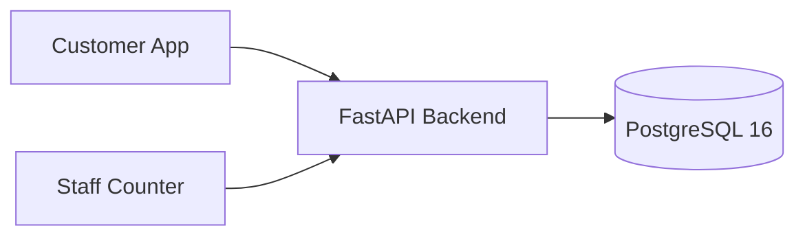
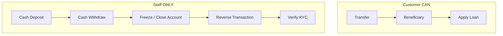
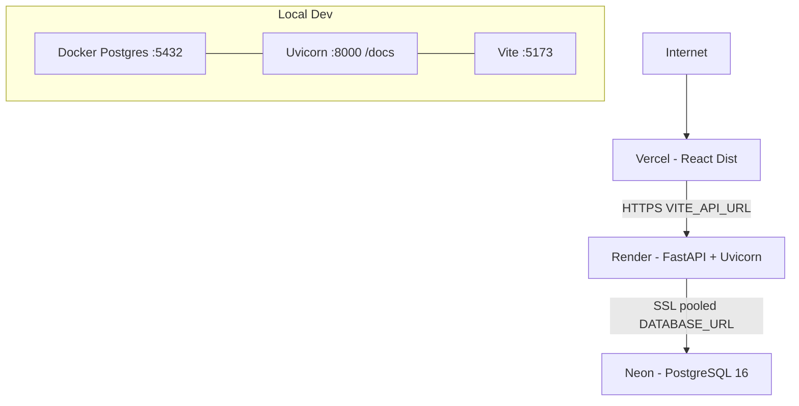
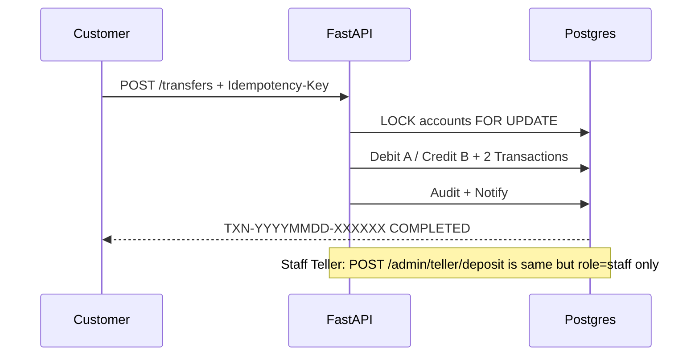
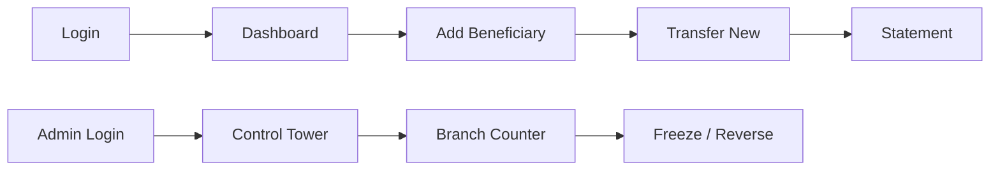

# PPT Generation Prompt — Banking Management System (6 Pages)

> Copy-paste the prompt inside the box into any AI PPT maker (Gamma / Tome / Canva AI / Copilot / Beautiful.ai).

---

## COPY THIS PROMPT:

```
Create a modern, professional 6-slide presentation for my project:

"BANKING MANAGEMENT SYSTEM — FastAPI + PostgreSQL + React"

Audience: college students + teacher. Tone: simple, confident, easy to explain.
Style: clean banking theme (navy blue + white), large headings, 4-5 bullet points max per slide,
one diagram on EVERY slide (use Mermaid.js), plus speaker notes (30 seconds per slide).

---

SLIDE 1 — FRONT / TITLE PAGE
Title: Banking Management System
Subtitle: Realistic Branch Banking — Customers Transfer, Staff Handles Cash
Show: Nexus Bank, FastAPI + PostgreSQL + React + Vite + TypeScript, Docker, Team/College name placeholder.
Diagram (Mermaid flowchart):


SLIDE 2 — WHAT IS IT & WHY IT IS REALISTIC
Explain in easy words: full-stack banking prototype, not real-money licensed system.
Key features: JWT auth, 4 roles, dashboard, transfers with TXN reference, loans + EMI, FD/RD, cards, statements, notifications, support.
Realistic rule highlight: USER has NO deposit/withdraw button — only Transfer. Only ADMIN / MANAGER / EMPLOYEE can do cash deposit/withdraw at Branch Counter. Freezing, KYC verify, reverse txn are staff-only.
Diagram (Mermaid mindmap or quadrant):


SLIDE 3 — SYSTEM ARCHITECTURE
Explain 3-tier: Vercel frontend -> Render backend -> Neon Postgres. Local: Docker Postgres + Uvicorn reload + Vite dev. Backend layers: routes validate, services own transactions, DB is source of truth.
Diagram (Mermaid architecture):


SLIDE 4 — ROLES, ADMIN POWER & MONEY SAFETY
Explain RBAC: customer < employee < manager < admin, enforced server-side every API. Admin Control Tower: suspend users, KYC verify/reject, freeze/close accounts, reverse txn, approve loans, manage branches, audit logs. Money safety: atomic transfer with SELECT FOR UPDATE, CHECK balance>=0, idempotency-key, double-entry Transaction DEBIT+CREDIT, audit row. Any failure = rollback.
Diagram (Mermaid sequence):


SLIDE 5 — DEMO FLOW + TECH STACK
Explain demo: Login as customer@example.com -> dashboard -> add beneficiary -> transfer -> statement. Login as admin@example.com -> Control Tower -> Branch Counter deposit -> freeze account -> reverse txn -> approve KYC/loan. Tech table: Frontend React18/Vite/TS/Tailwind/Query/Recharts, Backend Python3.12/FastAPI/Pydantic/SQLAlchemy/Alembic/JWT, Ops Docker/Compose/GitHub Actions/Vercel/Render/Neon.
Diagram (Mermaid user journey):


SLIDE 6 — CONCLUSION & THANK YOU
Conclusion in 3 lines: learned real banking rules, secure atomic money movement, clean role separation. Future scope: UPI hook, OTP/MFA, PDF passbook, interest cron, mobile app. Big THANK YOU + Q&A + demo links: /docs, /dashboard, /admin/teller. Placeholder for names.
Diagram (Mermaid simple closing):

---

Rules for generator: 6 slides only, title + bullets + one Mermaid diagram per slide, editable, add icons, keep text large and minimal.
```

---

### How to use
1. Copy the grey box above.
2. Paste into Gamma / Canva AI / Copilot PPT.
3. Select 16:9, banking theme, 6 slides.
4. Replace placeholders: college name, team members, demo URLs (`http://localhost:8000/docs`, `http://localhost:5173`, `/admin/teller`).
